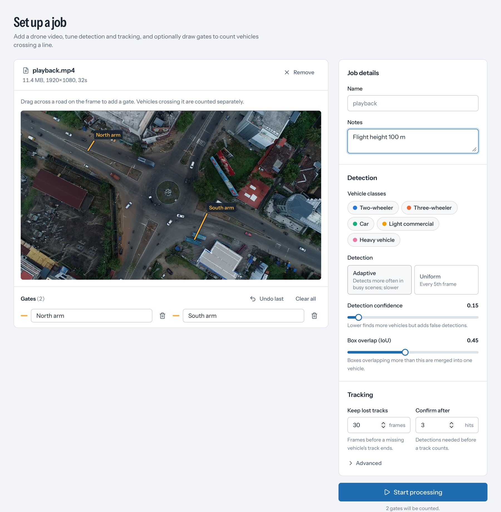
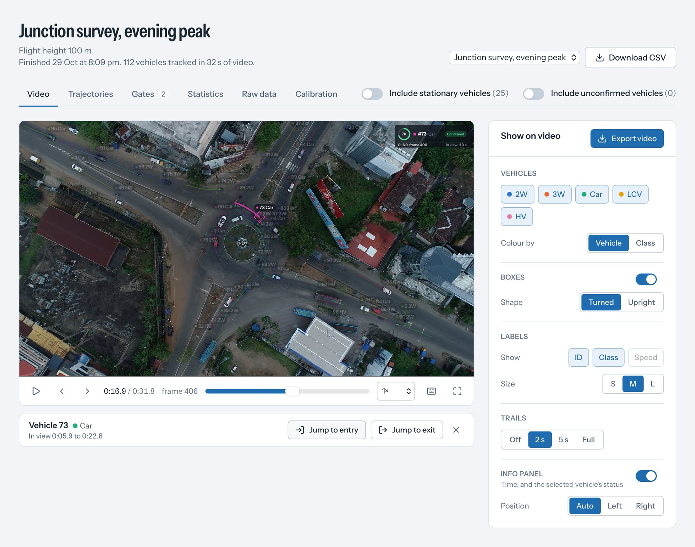
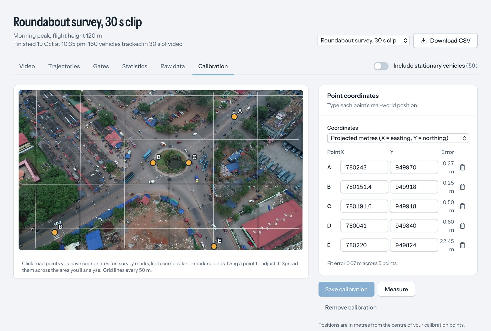

  
  <h1>DRISHT-E</h1>
  
<b>Drone Integrated System for Heterogeneous Traffic Extraction</b>

  
Turn drone footage of mixed traffic into vehicle trajectories, gate counts and speeds, from two-wheelers to heavy vehicles.

  

    <a href="../../releases/latest"><b>Download for Windows</b></a> ·
    <a href="docs/DRISHT-E_User_Guide.pdf"><b>User guide (PDF)</b></a> ·
    <a href="https://georgevjose.github.io/DRISHTE-Public/"><b>Website</b></a>
  

DRISHT-E is a desktop app for traffic engineers and researchers. Give it a video shot from a drone above a road,
and it finds every vehicle, follows each one through the video, and tells you where it went, what kind of vehicle it
was, which lines it crossed and, once you calibrate the view, how fast it was going.

It is built for the traffic Indian roads actually carry: lane-less and mixed, with two-wheelers weaving between cars,
auto-rickshaws, buses and trucks sharing the same space. It works at signalised and unsignalised intersections,
roundabouts and midblock sections.

Everything runs on your own computer. No internet connection is needed, and your videos never leave the machine.

## What you can do with it

| | |
| --- | --- |
| **Track every vehicle** | Each vehicle gets an ID, a class and a position in every frame of the video. |
| **Count at gates** | Draw lines across the roads you care about. DRISHT-E records every crossing, with the time and vehicle. |
| **Measure speeds** | Mark four or more points with known coordinates. Positions turn into metres and speeds into km/h. |
| **Watch the tracking** | Play the video with boxes, labels and trails drawn on, follow a single vehicle, and export the result as MP4. |
| **Read the scene** | Vehicles in view over time, the class mix, time in view, speed spread and a map of where vehicles drive. |
| **Know what to trust** | Every vehicle carries a status and a health score at every moment, so doubtful tracks stand out. |
| **Take the data anywhere** | Download everything as CSV for Excel, Python, R or MATLAB. |

## How it works

1. **Set up a job.** Add a drone video, choose which vehicle classes to detect, and draw gates on a frame of the video.
2. **Process.** DRISHT-E detects and tracks every vehicle. Jobs queue and run one at a time in the background.
3. **Review results.** Watch the tracked video, study trajectories and statistics, calibrate for speeds, and download the data.

<table>
  <tr>
    <td width="50%"></td>
    <td width="50%"></td>
  </tr>
  <tr>
    <td>Set up a job and draw gates on the video.</td>
    <td>Play the tracked video and follow any vehicle.</td>
  </tr>
  <tr>
    <td></td>
    <td></td>
  </tr>
  <tr>
    <td>Inspect every trajectory, with speed over time.</td>
    <td>Calibrate once for positions in metres and speeds in km/h.</td>
  </tr>
  <tr>
    <td></td>
    <td></td>
  </tr>
  <tr>
    <td>See the scene's statistics at a glance.</td>
    <td>Count crossings at every gate and download them.</td>
  </tr>
</table>

## Vehicle classes

| Class | Includes |
| --- | --- |
| Two-wheeler (2W) | Motorcycles, scooters, bicycles |
| Three-wheeler (3W) | Auto-rickshaws, e-rickshaws |
| Car | Hatchbacks, sedans, SUVs |
| Light commercial (LCV) | Vans, pickups, small goods vehicles |
| Heavy vehicle (HV) | Buses, trucks, heavy commercial vehicles |

## What you get

- **Tracking data:** one row per vehicle per frame, with its ID, class, box, position, direction of travel, a status
  and a health score. Calibrated jobs add positions in metres and speeds in km/h.
- **Gate crossings:** every crossing at every gate, with the vehicle, frame and time, plus the full paths of the
  vehicles that crossed.
- **A tracked video:** exported as MP4 at the range and resolution you choose, with the overlays you set.

Parked vehicles and doubtful tracks are flagged rather than deleted, so you decide what to count. The
[user guide](docs/DRISHT-E_User_Guide.pdf) explains every column.

## System requirements

- Windows 10 or Windows 11, 64-bit
- 16 GB RAM recommended
- About 6 GB of free disk space for the program, plus room for your videos and results
- Optional but recommended: an NVIDIA GPU with a recent driver. Without one, DRISHT-E runs on the processor, which is
  much slower.
- No internet connection needed

## Download and install

1. Open the [latest release](../../releases/latest) and download **every file**: `DRISHT-E-Setup-<version>.exe` and
   all the `DRISHT-E-Setup-<version>-N.bin` files. Put them in the same folder.
2. Run `DRISHT-E-Setup-<version>.exe`. No administrator rights are needed.
3. If Windows shows "Windows protected your PC", click **More info**, then **Run anyway**. The installer isn't
   code-signed yet.
4. Open DRISHT-E from the Start menu. The first start can take a minute or two.

To update, install the new version over the old one; your jobs and settings are kept. Results, settings and logs live
in `%LOCALAPPDATA%\DRISHT-E`, and uninstalling leaves them in place.

## User guide

The [DRISHT-E User Guide](docs/DRISHT-E_User_Guide.pdf) (PDF, 27 pages) covers installing, setting up jobs, every
results tab, calibration, the data files, and troubleshooting.

## About

DRISHT-E is designed and developed by **George V Jose** at Transportation Systems Engineering, Indian Institute of
Technology Bombay.

  
  &nbsp;&nbsp;
  

This repository holds the user guide, the website and the Windows downloads. The software is distributed only as the
installer on the [Releases](../../releases) page.

© 2026 George V Jose
