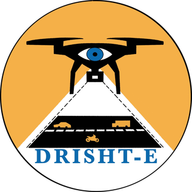
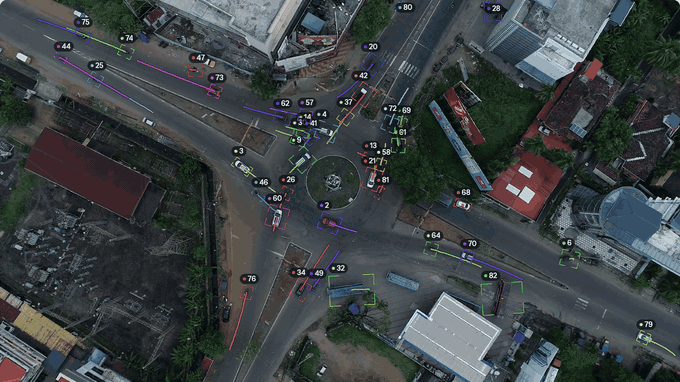
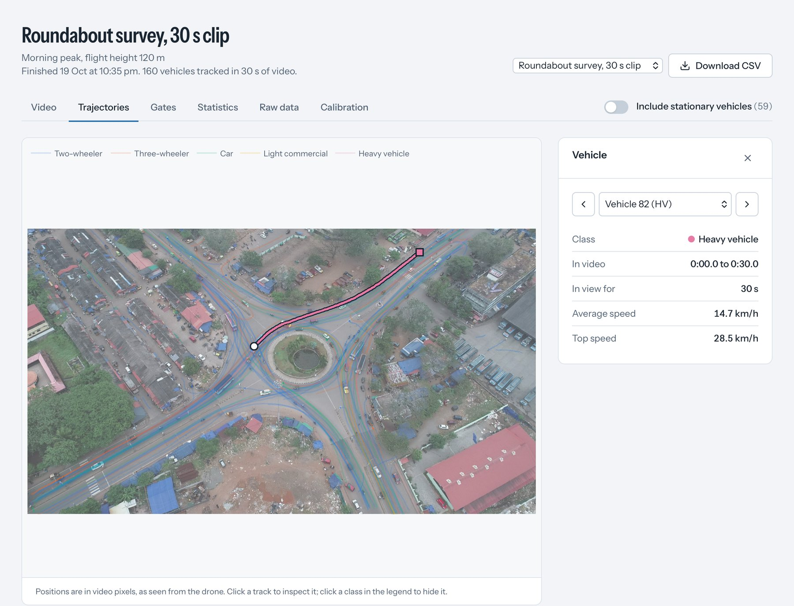
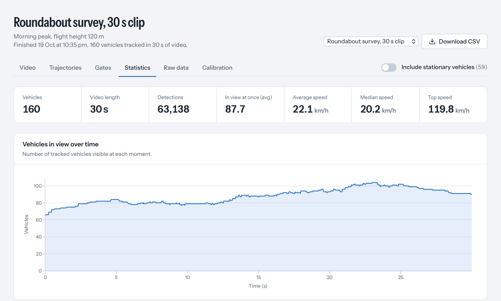
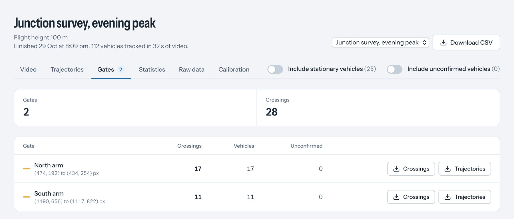
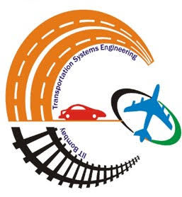

  
  <h1>DRISHT-E</h1>
  
<b>Drone Integrated System for Heterogeneous Traffic Extraction</b>

  
Count, classify and measure every vehicle on a road from a single drone video.

  

    <a href="../../releases/latest"><b>Download for Windows</b></a> ·
    <a href="docs/DRISHT-E_User_Guide.pdf"><b>User guide (PDF)</b></a> ·
    <a href="https://georgevjose.github.io/DRISHTE-Public/"><b>Website</b></a>
  

*Each box is one vehicle that DRISHT-E has found. The colour shows its type, the number is its ID, and the tail traces
where it has just been.*

Film a junction or a stretch of road from above. DRISHT-E picks out every motorbike, auto-rickshaw, car, van, bus and
truck, follows each one through the video, and tells you how many passed, which way they went and how fast they were
moving.

## Why count traffic from the sky?

A new signal, flyover, footpath or bus lane starts with the same questions. How many vehicles use this road? What
kinds? Which way do they turn, and how fast do they go?

The usual answer is a team at the junction with tally sheets, or someone watching hours of video and clicking a
counter. On Indian roads, where two-wheelers weave between cars and autos and buses and trucks share the same space
without lanes, that is especially hard. From above, one camera covers an entire junction, and DRISHT-E does the
watching: it finds each vehicle, follows it from frame to frame, and turns the video into numbers you can put in a
report.

Everything runs on your own computer. No internet connection is needed, and your videos are never uploaded anywhere.

## How it works

1. **Film the road.** Fly a drone over the junction or road. Keep it steady, point the camera as straight down as you
   can, and keep the whole study area in view.
2. **Set up a job.** Load the video, choose which vehicle types to look for, and draw counting lines, called *gates*,
   across the roads you want counted.
3. **Let it process.** DRISHT-E finds and follows every vehicle by itself, in the background. Queue several videos and
   they run one after another. An NVIDIA graphics card makes this about ten times faster.
4. **Review and download.** Watch the video with every vehicle marked, check the counts and charts, add a few known
   ground points to get speeds in km/h (*calibration*), and download the data.

You don't need any programming: everything is point and click, and the default settings are tuned for Indian drone
footage.

## What it measures

Everything downloads as CSV spreadsheets that open in Excel, Google Sheets, Python, R or MATLAB.

| | |
| --- | --- |
| **Classified volume counts** | Every vehicle that crosses a gate is logged with its ID and the time; its type comes from the tracking data. Group crossings into 5- or 15-minute intervals as you need. |
| **Turning movements** | Put a gate on every arm of a junction or roundabout. A vehicle keeps the same ID at every gate it crosses, so matching the arm it entered on with the arm it left by gives you turning counts. |
| **Spot speeds** | Once the video is calibrated, every gate crossing also records the vehicle's speed in km/h at that line. |
| **Speeds through the scene** | Each vehicle's speed over time, with its average and top speed, plus a speed distribution for the whole video. |
| **Vehicle trajectories** | The position of every vehicle in every frame, in metres once calibrated, with its direction of travel and size. |
| **Traffic mix and activity** | The share of each vehicle type, how many vehicles were in view over time, how long they stayed, and a heat map of where vehicles drive. |

<table>
  <tr>
    <td width="50%"></td>
    <td width="50%"></td>
  </tr>
  <tr>
    <td>Set up a job and draw counting lines (gates) on the video.</td>
    <td>Play the tracked video and follow any vehicle.</td>
  </tr>
  <tr>
    <td></td>
    <td></td>
  </tr>
  <tr>
    <td>See every vehicle's path, with speed over time.</td>
    <td>Calibrate once for positions in metres and speeds in km/h.</td>
  </tr>
  <tr>
    <td></td>
    <td></td>
  </tr>
  <tr>
    <td>See the scene's statistics at a glance.</td>
    <td>Count crossings at every gate and download them.</td>
  </tr>
</table>

## Numbers you can check

Any software makes mistakes, especially in dense traffic, under trees or at the edge of the frame. DRISHT-E shows you
where its results are doubtful rather than quietly hiding them.

- **Doubtful vehicles are flagged, not deleted.** Tracks DRISHT-E never became confident about are marked
  *unconfirmed*, and parked vehicles *stationary*. Both are left out of on-screen results by default, with a switch to
  bring them back, and stay in the downloads with a flag column.
- **Counts show what was left out.** Gate totals include confirmed vehicles only; crossings by unconfirmed tracks are
  listed in their own column.
- **Every moment has a confidence score.** In every frame, each vehicle has a health score and a status, such as
  *Hidden*, *Leaving the frame* or *Suspect* (the track may have jumped to another vehicle).
- **Calibration checks itself.** Each point shows its own error, a point that disagrees with the rest is named, and
  swapped coordinates are refused.

Before you put a vehicle's path or speed in a report, follow it in the video and check it isn't marked Suspect or low
in health.

## Vehicle types

DRISHT-E sorts vehicles into five types. The short code is what appears in the data.

| Type | Includes |
| --- | --- |
| Two-wheeler (2W) | Motorcycles, scooters, bicycles |
| Three-wheeler (3W) | Auto-rickshaws, e-rickshaws |
| Car | Hatchbacks, sedans, SUVs |
| Light commercial (LCV) | Vans, pickups, small goods vehicles |
| Heavy vehicle (HV) | Buses, trucks, heavy commercial vehicles |

## System requirements

- Windows 10 or Windows 11, 64-bit
- 16 GB RAM recommended
- About 6 GB of free disk space for the program, plus room for your videos and results
- Recommended: an NVIDIA graphics card with a recent driver. Without one, DRISHT-E still works, but processing is
  much slower.
- No internet connection needed

## Download and install

1. Open the [latest release](../../releases/latest) and download **every file**: `DRISHT-E-Setup-<version>.exe` and
   all the `DRISHT-E-Setup-<version>-N.bin` files. Put them in the same folder.
2. Run `DRISHT-E-Setup-<version>.exe`. No administrator rights are needed.
3. If Windows shows "Windows protected your PC", click **More info**, then **Run anyway**. The warning appears because
   the installer doesn't carry a digital signature yet.
4. Open DRISHT-E from the Start menu. The first start can take a minute or two.

To update, install the new version over the old one; your jobs and settings are kept. Results, settings and logs live
in `%LOCALAPPDATA%\DRISHT-E`, and uninstalling leaves them in place.

## User guide

The [DRISHT-E User Guide](docs/DRISHT-E_User_Guide.pdf) (PDF, 27 pages) covers installing, setting up jobs, every
results tab, calibration, the data files, and troubleshooting, with an explanation of every column in the data.
Read "Things to remember" before your first survey.

## About

DRISHT-E is designed and developed by **George V Jose** at Transportation Systems Engineering, Indian Institute of
Technology Bombay.

  
  &nbsp;&nbsp;
  

This repository holds the user guide, the website and the Windows downloads. The software is distributed only as the
installer on the [Releases](../../releases) page.

© 2026 George V Jose
